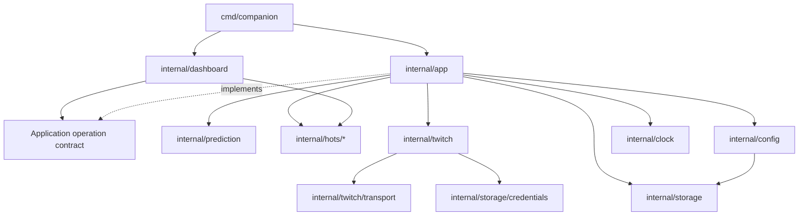

# Architecture

HotS Twitch Companion is one Windows executable with an embedded HTML/CSS/JavaScript UI. Desktop uses Wails/WebView2; BrowserFallback serves the same UI through a protected loopback HTTP listener. Both launchers compose the same application.

## Package ownership

| Package | Responsibility |
| --- | --- |
| `cmd/companion` | Version/linker defaults, composition, Windows profile lock and error dialog, Wails/Edge launchers, tray and `.syso` resources |
| `internal/app` | Engine, monitoring, configuration/auth ownership checks, durable creation and settlement orchestration, recovery |
| `internal/config` | Existing configuration JSON schema, defaults, translated prediction text, profile paths and config persistence |
| `internal/prediction` | Persisted prediction/evidence/queue models and pure state transitions; independent snapshots |
| `internal/hots/lobby` | Bounded BattleLobby decoder and stable read-only lobby capture |
| `internal/hots/replay` | MPQ archive reading, versioned details decoder and player outcome selection |
| `internal/hots/discovery` | Bounded on-disk lobby/replay discovery and replay counts |
| `internal/hots/correlation` | Match binding and strict roster, identity, timing, stable-file and ambiguity checks; scan result contract |
| `internal/twitch` | Synchronized OAuth/Helix client, Device Flow, refresh/validation, creation checks and read-before-write settlement reconciliation |
| `internal/twitch/transport` | Bounded HTTP serialization and typed HTTP/rate-limit errors |
| `internal/storage` | Atomic JSON persistence, StateStore, reset and legacy simulation migration |
| `internal/storage/credentials` | DPAPI protection and encrypted token-file persistence; platform-specific implementations |
| `internal/clock` | Injected time source |
| `internal/i18n` | Backend language normalization and message catalog |
| `internal/dashboard` | Consumer-owned application contract, UI status/replay/log views, guarded HTTP routes, embedded assets and public release checks |
| `assets` | Shared embedded Windows icon and resource generator |

## Dependencies and boundaries



The operation contract lives with its consumer in `internal/dashboard/application.go`. Dashboard does not import `internal/app`; it knows only operations and shared configuration, prediction, correlation and Twitch records. Engine does not import Dashboard. This permits integration tests to exercise the real HTTP/application boundary without a package cycle.

Dashboard never reads or changes Engine fields, locks or tokens. `Snapshot` returns an independent copy of the durable state, including nested match evidence and queued lobbies. `Connection` returns only connection metadata. Tokens are never included in UI responses.

`app.Options` accepts a `PredictionAPI`, `StateStore`, `Clock`, JSON request transport, game source and logging callbacks. Defaults use the disk profile and a per-instance HTTP client. The public linker Client ID remains in the command and is passed as an instance option; explicit user configuration takes precedence.

`twitch.Client` receives a `TokenStore` and request function. `FileTokens` delegates encrypted persistence to `storage/credentials`. OAuth validation precedes token installation; Engine checks that active or unconfirmed predictions still belong to the candidate broadcaster and OAuth application.

## Lifecycle and durable ordering

```text
LobbyDetected -> Preflight -> CreationAttempted -> PredictionActive
                                                   |
                                                   v
                                            SettlementPending
                                                   |
                                                   v
                                            Completed / Canceled
```

These are operational stages, not a new serialized enum. Existing JSON fields retain their meaning.

1. Capture a stable lobby and persist the pending queue. Previously consumed lobby SHAs cannot produce a second wager.
2. Run read-only identity and open-prediction checks. Failures before creation remain safe to retry.
3. Persist consumption and `UnconfirmedCreation` **before** sending the creation POST.
4. Persist a confirmed remote prediction and match binding only after validating its response. A lost or invalid POST response leaves the creation unconfirmed; automatic creation does not retry. Explicit user reconciliation verifies the original broadcaster before clearing uncertainty.
5. Correlate completed replay evidence against the bound lobby and selected ToonHandle. Unsupported rosters, unstable files, missing timing/identity evidence and multiple candidates cannot trigger automatic payouts.
6. Persist Win/Loss/Cancel intent before contacting Twitch. The selected outcome cannot change while a settlement is pending. Remote state is read and checked before writing; retry deadlines preserve rate-limit guidance.
7. Persist completion before forgetting the active prediction. Restart loads active predictions, settlement intents, creation uncertainty, consumed lobby history and queued lobbies.

Pure transitions remain in `internal/prediction`; Engine controls the ordering of persistence and external effects.

## Mutable state and synchronization

Engine owns configuration, lifecycle state, replay scan status and monitoring state. `actionMu` serializes scanner ticks, manual outcomes/rechecks, token installation, configuration changes and reset authorization. `mu` protects shared in-memory fields. Lock order is `actionMu` then `mu`, followed by the Twitch client's private lock when needed. The Twitch client owns its token and validated identity and serializes refresh and credential commits.

Language, wizard and future prediction settings reuse the live Twitch client. Title, outcome labels and duration may change while monitoring; the action lock prevents changes midway through creation. Player identity, replay source, mode and OAuth application remain fixed during monitoring. Changing the OAuth application cannot strand an active real prediction or unconfirmed creation. Failed configuration or credential saves do not commit a replacement in memory.

New predictions persist their own `windowSeconds` estimate. Existing profiles without that optional field use the saved configuration until the duration is changed; the previous duration is then written to the active prediction before saving the new configuration. A failed state write blocks that change. This additive field preserves compatibility with older profiles and prevents settings for the next wager from rewriting the active timer.

Dashboard validates saved Twitch credentials on startup and once a minute, with cancellation at shutdown. Failures clear the cached connected identity while retaining credentials for a later retry; these checks never start monitoring or create predictions. The UI marks a failed status request as a lost connection, preserves the last known data with an explicit warning and blocks mutation actions until polling succeeds again.

Dashboard owns its logs, replay cache, authorization progress, activity timer and shutdown signal. Its POST mutex serializes user operations, including the reset-to-shutdown sequence. Engine authorizes reset under the lifecycle action lock and rejects it while monitoring, an active prediction or unconfirmed creation exists.

## Compatibility and local transport

Profile paths remain `%LOCALAPPDATA%/HotSTwitchCompanion` (with the existing `UserConfigDir` fallback). `config.json`, `state.json`, `tokens.dpapi`, `.new` replacement files and `.reset-profile` retain their existing formats and behavior. Startup takes the Windows profile lock before applying reset or loading credentials. Legacy simulation migration preserves real prediction and recovery evidence.

`internal/dashboard/assets.go` embeds `web/` relative to its own package. The guarded router supplies the same files and API to both launchers. Wails adapts paths for `wails.localhost` without changing caller Host, Origin, headers or body. BrowserFallback binds only `127.0.0.1` on an ephemeral port and uses an unguessable URL segment.

Routes and response JSON remain compatible, including bootstrap/status/replays, configuration, OAuth, replay/root checks, manual/recheck/reconciliation operations, automation, reset, quit and tray hiding. Host, URL capability, `X-Companion`, Origin, Fetch-Site, request-size/JSON checks and security headers are preserved. UI prediction phases describe local knowledge, not freshly verified Twitch state.

## Build and validation

`cmd/companion/version.go` is the build version source. `build-version.ps1` reads it; `-X main.defaultTwitchClientID=...` still embeds only the public OAuth Client ID. The generated `.syso` stays beside the Windows entry points; `assets/generate.ps1` writes it there. Node tests and syntax checks read `internal/dashboard/web`.

Run from the repository root:

```powershell
go test ./...
go test -race ./...
go vet ./...
go test -tags "wails,production,wv2runtime.error" ./...
go vet -tags "wails,production,wv2runtime.error" ./...
node --test
./build.ps1
./build.ps1 -BrowserFallback
```

Race testing requires CGO and a supported C compiler; the Windows Actions race job provides that environment. The build scripts run both Go configurations, vet, every JavaScript syntax check and the Node suite before packaging.

Package tests cover parsers, pure transitions, compatibility and persistence failures. The integration suite in `internal/app` exercises real Dashboard/Engine operations, HTTP guards, stale identities, ambiguous replays, write-ahead ordering and recovery. Its convenience fixtures exist only in `_test.go` files. `cmd/companion` tests cover Windows profile exclusivity and reset startup. All Twitch writes in tests use fake APIs or intercepted/local transports; no live channel authorization or viewer points are used.
